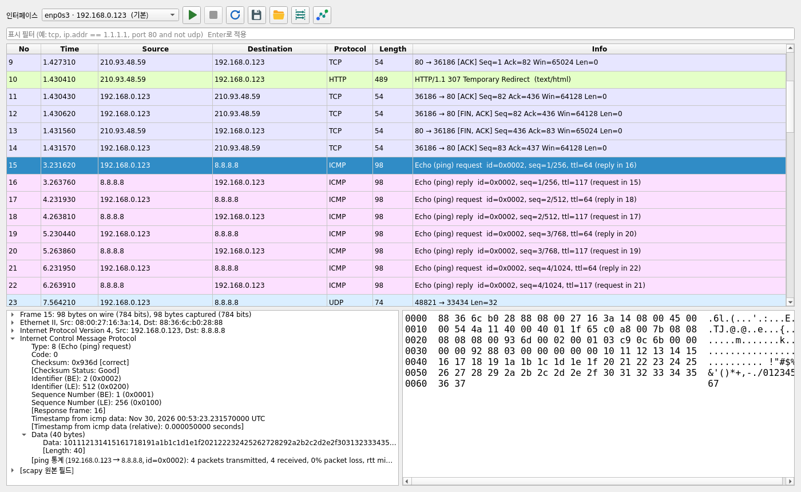
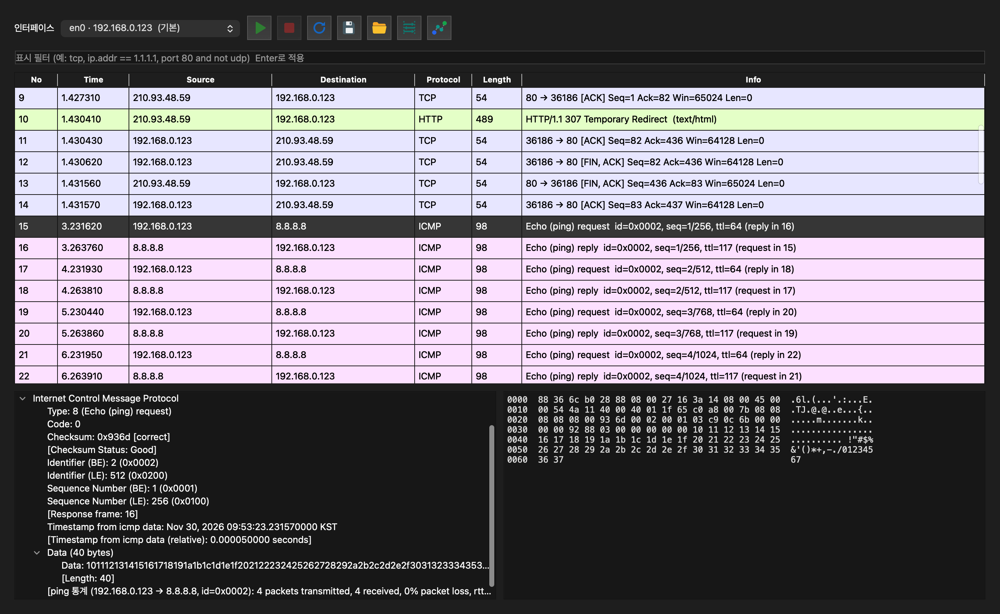
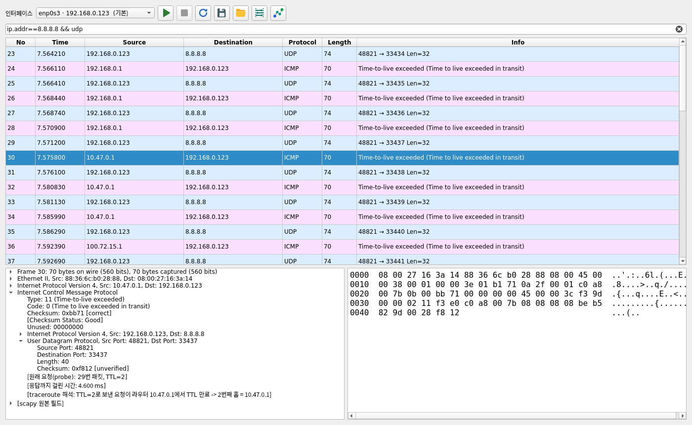
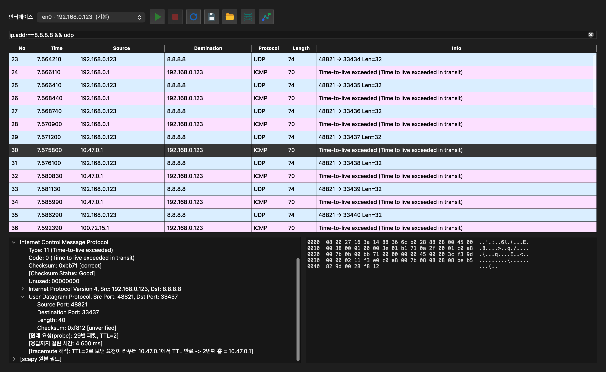
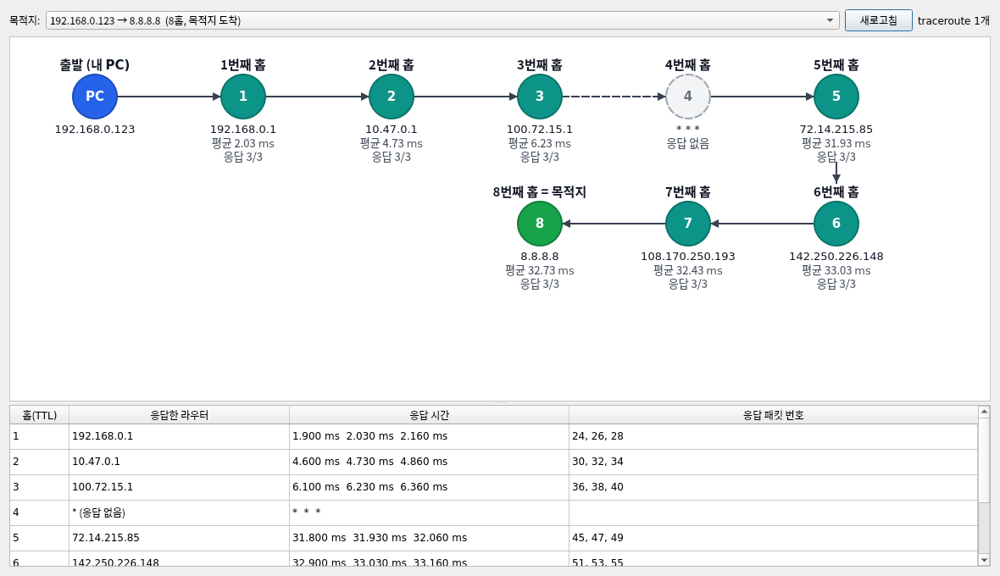
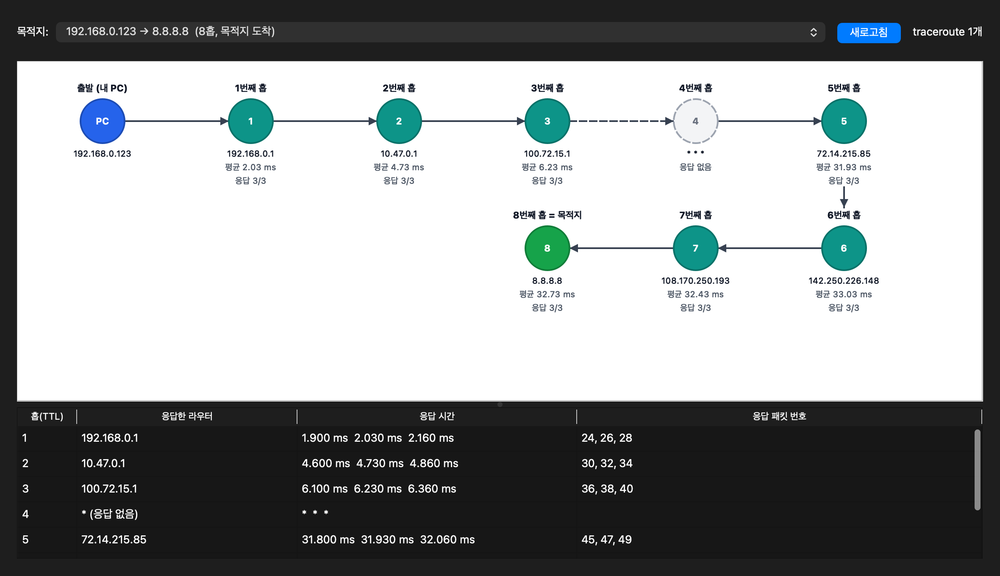
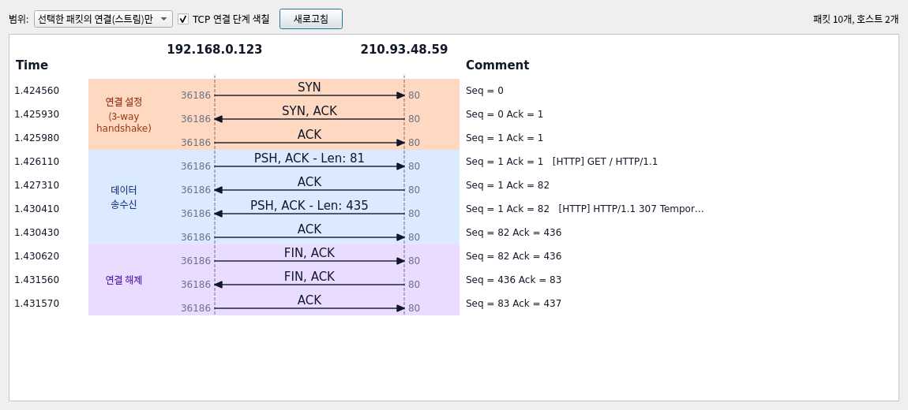
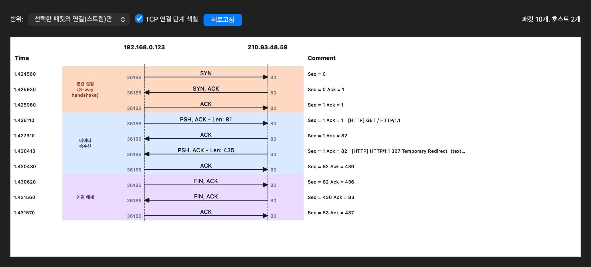
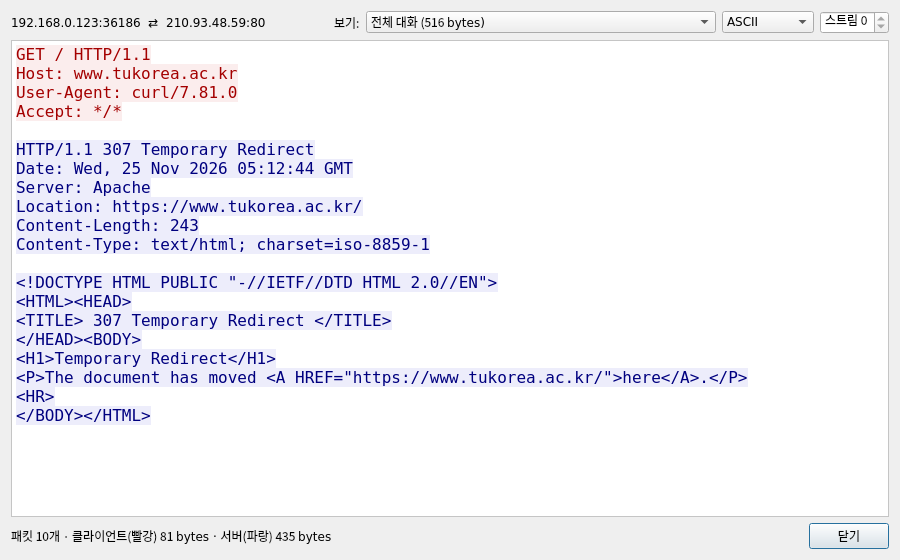
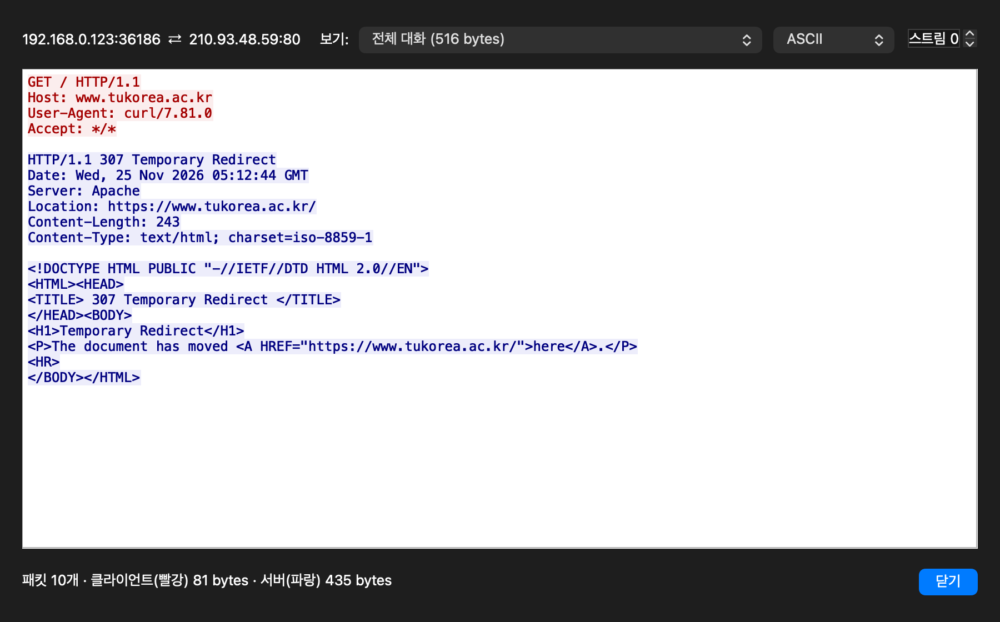

# 🦈 watchThePacket

**패킷을 직접 잡아서 보는 Wireshark 스타일 패킷 분석기** (앱 이름: MiniWireShark)

scapy로 패킷을 캡처하고 PySide6(Qt)로 보여준다.
`nslookup`, `curl`, `netstat`, `ping`, `traceroute`를 실행했을 때 **어떤 패킷이 오가는지**를
Wireshark처럼 목록 · 상세 트리 · 흐름도 · 경로 그림으로 확인할 수 있다.

> 2026-2학기 컴퓨터네트워크 팀 프로젝트 (주요 네트워크 명령어 ↔ 프로토콜 연계 분석)


<p align="center">
  
  <br><sub>Ubuntu 22.04 · ping 요청을 선택한 화면 (ICMP 상세: Identifier/Sequence BE·LE, Timestamp from icmp data, Response frame, ping 통계)</sub>
</p>

---

## 목차

1. [스크린샷 (Ubuntu · macOS)](#스크린샷-ubuntu--macos)
2. [빠른 시작](#빠른-시작)
3. [주요 기능](#주요-기능)
4. [화면 사용법](#화면-사용법)
5. [과제 실습 가이드 (명령어별)](#과제-실습-가이드-명령어별)
6. [표시 필터 문법](#표시-필터-문법)
7. [문제 해결](#문제-해결)
8. [확인한 환경](#확인한-환경)
9. [Wireshark로 검증하기](#wireshark로-검증하기)
10. [과제 제출용 zip](#과제-제출용-zip)
11. [폴더 구조](#폴더-구조)
12. [개발자용](#개발자용)

---

## 스크린샷 (Ubuntu · macOS)

같은 코드가 두 운영체제에서 똑같이 동작한다. 왼쪽은 실습 환경인 **Ubuntu 22.04**(Qt 기본 Fusion 스타일), 오른쪽은 **macOS**(다크 모드)다.

<table>
<tr><th width="50%">Ubuntu 22.04</th><th width="50%">macOS</th></tr>
<tr>
<td></td>
<td></td>
</tr>
<tr><td colspan="2" align="center"><b>메인 화면</b> · 패킷 목록(프로토콜별 색) · 상세 트리 · hex. ping 요청을 고르면 짝꿍 응답 번호와 터미널 ping 통계까지 보인다</td></tr>
<tr>
<td></td>
<td></td>
</tr>
<tr><td colspan="2" align="center"><b>traceroute 상세</b> · 필터 <code>ip.addr==8.8.8.8 &amp;&amp; udp</code> — 라우터의 <code>Time-to-live exceeded</code> 안에 든 원래 UDP 헤더, 원래 요청 번호, <code>[traceroute 해석]</code></td></tr>
<tr>
<td></td>
<td></td>
</tr>
<tr><td colspan="2" align="center"><b>traceroute 경로</b> · <code>traceroute 8.8.8.8</code> — 내 PC → 라우터 → 목적지. 응답 없는 홉(<code>* * *</code>)은 점선, 홉마다 평균 응답 시간</td></tr>
<tr>
<td></td>
<td></td>
</tr>
<tr><td colspan="2" align="center"><b>흐름도</b> · <code>curl</code> 한 번의 TCP 연결: 3-way handshake → HTTP 요청/응답 → 연결 해제를 단계별로 색칠</td></tr>
<tr>
<td></td>
<td></td>
</tr>
<tr><td colspan="2" align="center"><b>스트림 따라가기</b> · 표에서 우클릭 → Follow TCP Stream. 요청은 빨강, 응답은 파랑</td></tr>
</table>

<sub>스크린샷은 실제 명령어(<code>nslookup</code>, <code>curl</code>, <code>ping -c 4 8.8.8.8</code>, <code>traceroute 8.8.8.8</code>)와 같은 모양으로 만든 예시 세션이다. 공개 저장소라 개인 IP와 통신사 라우터 주소가 나오지 않게 내 PC는 <code>192.168.0.123</code>, 중간 라우터는 사설 대역으로 바꿨다.</sub>

---

## 빠른 시작

### Ubuntu (실습 환경, 22.04 / 24.04)

터미널(`Ctrl + Alt + T`)을 열고 한 줄씩 실행한다.

```bash
sudo apt update && sudo apt install -y git
```
```bash
git clone https://github.com/AnemoneCoronaria/watchThePacket.git
```
```bash
cd watchThePacket
```
```bash
./install.sh
```
```bash
./run.sh
```

- `install.sh`, `run.sh` 둘 다 sudo 비밀번호를 물어본다 (패키지 설치 / 패킷 캡처에 관리자 권한 필요)
- 설치는 처음 한 번만. 그다음부터는 `cd watchThePacket` 후 `./run.sh`만 하면 된다
- 최신 코드로 바꾸려면 `git pull`

### macOS

```bash
git clone https://github.com/AnemoneCoronaria/watchThePacket.git && cd watchThePacket
```
```bash
./install.sh
```
```bash
./run.sh
```

### 스크립트가 하는 일

| 스크립트 | 하는 일 |
|---|---|
| `install.sh` | (Ubuntu) Qt 창에 필요한 패키지 설치 → `.venv` 가상환경 만들고 `requirements.txt` 설치 → 화면 파일(`ui_main.py`, `res_rc.py`) 만들기 |
| `run.sh` | 화면 파일이 없거나 오래됐으면 다시 만들기 → (Ubuntu) root가 화면에 창을 띄울 수 있게 잠깐 허락(`xhost`) → `sudo -E`로 실행 → 끝나면 허락 취소 |

직접 하고 싶으면 [개발자용](#개발자용) 참고.

---

## 주요 기능

| 기능 | 설명 |
|---|---|
| 캡처 | 인터페이스 선택(기본 / 루프백 / IP 있는 것 전부), 시작 · 정지 · 재시작, pcap 저장 · 열기 |
| 패킷 목록 | No, Time, Source, Destination, Protocol, Length, Info + 프로토콜별 색 |
| Info 칸 | Wireshark처럼: 상대 Seq/Ack (`Seq=0`), 배율 계산한 창 크기 (`Win=64256`), TCP 플래그/옵션/SACK, DNS `Standard query 0x005c A ...`, HTTP 첫 줄, TLS 단계(SNI), ping `id=0x0002, seq=1/256, ttl=64 (reply in 91)` |
| TCP 분석 | `[TCP Retransmission]` `[TCP Out-Of-Order]` `[TCP Fast Retransmission]` `[TCP Spurious Retransmission]` `[TCP Keep-Alive]` `[TCP Dup ACK]` (Wireshark 판정 규칙 그대로), 여러 패킷에 나뉜 HTTP 재조립 |
| 상세 트리 | Frame / Ethernet II / IP / TCP·UDP / DNS·HTTP·TLS·ICMP·ARP. 플래그 비트 분해, DNS Queries/Answers(TTL), HTTP 헤더·본문 |
| ping 상세 | Identifier/Sequence (BE·LE), `Checksum [correct]`, `Timestamp from icmp data`(Ubuntu · macOS ping 둘 다 마이크로초까지), Data, `[Response time]`, 터미널 ping 맨 끝과 같은 `[ping 통계: 4 packets transmitted, 4 received, 0% packet loss, rtt min/avg/max/mdev = ...]` |
| traceroute 상세 | ICMP 에러 안에 들어있는 원래 IP / UDP 헤더 전체, 원래 요청(probe) 패킷 번호, `[traceroute 해석: TTL=2로 보낸 요청이 라우터 X에서 만료 -> 2번째 홉]` |
| 요청 ↔ 응답 | DNS `[Response In]` `[Time]`, HTTP `[Request in frame]`, ping `[Response time]` |
| TCP 연결 단계 | `[연결 단계: 연결 설정 (3-way handshake) 1/3: SYN]` / 데이터 송수신 / 연결 해제 |
| 흐름도 | 호스트별 세로선 + 화살표. TCP 연결 단계를 색칠. 필터 결과를 따라 바뀜 |
| 스트림 따라가기 | 표에서 우클릭 → Follow TCP/UDP Stream. 요청은 빨강, 응답은 파랑 (ASCII / UTF-8 / Hex) |
| traceroute 경로 | 내 PC → 라우터들 → 목적지를 그림으로. 응답 없는 홉, 여러 갈래 경로, 도착 여부 표시 |
| 표시 필터 | `udp && ip.addr==210.93.48.196`, `tcp.flags.syn==1`, `dns.qry.name contains "tukorea"` 등 |

---

## 화면 사용법

### 툴바 (왼쪽부터)

| 항목 | 설명 |
|---|---|
| 인터페이스 | 캡처할 네트워크. 처음엔 기본 인터페이스(Ubuntu VM은 보통 `enp0s3`)가 골라져 있음. 캡처 중엔 못 바꿈 |
| ▶ 시작 / ■ 정지 | 캡처 시작 / 멈춤. 창 제목에 `enp0s3에서 캡처 중 · 패킷 N개`가 나옴 |
| ↻ 재시작 | 표를 비우고 처음부터 |
| 💾 저장 / 📂 열기 | `.pcap` 파일 저장 / 불러오기 (Wireshark 파일도 열림) |
| 흐름도 | 지금 보이는 패킷(필터 결과)의 흐름도. 줄을 누르면 그 패킷이 선택됨 |
| 경로 | traceroute 경로 그림. 동그라미나 아래 표를 누르면 그 응답 패킷이 선택됨 |

### 그 밖에

- **필터 칸**: 쓰고 **Enter**. 지우면 필터 해제. 문법이 틀리면 빨개지고, 마우스를 올리면 이유가 나옴
- **표에서 우클릭**: TCP/UDP 스트림 따라가기, 이 연결만 흐름도, 필터 지우기
- **화살표 키**로 행을 옮겨도 상세 트리 / hex가 바뀜

### 끄기

- 메인 창의 **X** 버튼: 캡처를 멈추고 흐름도 · 스트림 · 경로 창까지 한 번에 닫힌다
- 흐름도 · 스트림 · 경로 창의 X는 그 창만 닫는다 (버튼을 다시 누르면 다시 열림)
- `./run.sh`를 실행한 터미널에서 **Ctrl + C**: X를 누른 것과 똑같이 깔끔하게 꺼진다

---

## 과제 실습 가이드 (명령어별)

`./run.sh`로 켜고 **▶ 시작**을 누른 다음, 다른 터미널에서 명령어를 실행한다.

| 명령어 | 실행 예 | 필터 | 볼 것 |
|---|---|---|---|
| nslookup | `nslookup www.tukorea.ac.kr 210.93.48.196` | `udp && ip.addr==210.93.48.196` | 질의/응답 2개, 응답 상세의 Answers와 `[Request In]` `[Time]` |
| curl | `curl -v http://www.tukorea.ac.kr` | `tcp && ip.addr==210.93.48.59` | 흐름도: 3-way handshake → GET/307 → 연결 해제. 우클릭 → 스트림 따라가기 |
| netstat | curl 직후 `netstat -an \| grep 210.93.48.59` | `tcp.phase==teardown` | `TIME_WAIT` ↔ 흐름도에서 내 쪽이 마지막 ACK를 보낸 것 |
| ping | `ping -c 5 www.tukorea.ac.kr` | `ip.addr==210.93.48.59 && icmp` | 요청/응답 10개, `seq=1/256`, `(reply in N)`, 응답 상세의 `[Response time]`과 `[ping 통계]` ↔ 터미널 맨 끝 통계 |
| traceroute | `traceroute computer.tukorea.ac.kr` | `ip.addr==210.93.57.50`, `ip.addr==210.93.57.50 && udp.port==33434` | UDP(TTL 1,2,3…) ↔ 라우터의 `Time-to-live exceeded`, 목적지의 `Port unreachable`. **경로** 버튼 그림, 상세의 `[traceroute 해석]` |

학교 밖에서 연습할 때 (응답이 잘 오는 대상):

| 명령어 | 실행 예 | 필터 |
|---|---|---|
| ping | `ping -c 4 8.8.8.8` | `ip.addr==8.8.8.8 && icmp` |
| traceroute | `traceroute 8.8.8.8` | `ip.addr==8.8.8.8 && udp` (요청 + 라우터 응답 전부), `ip.addr==8.8.8.8 && udp.port==33434` (첫 요청과 그 응답) |
| curl | `curl -v http://example.com` | `tcp && http` |

- curl의 IP는 출력 맨 위 `Trying 210.93.48.59:80...`에서 확인 (바뀔 수 있음)
- Ubuntu `nslookup`의 기본 서버 `127.0.0.53`은 루프백이라, 위처럼 서버를 지정하거나 인터페이스를 "IP 있는 것 전부"로 고른다
- 3차 설명서처럼 `ip.addr==210.93.57.50` 필터에 **라우터가 보낸 응답도 같이 걸린다**. ICMP 에러 안에 내가 보낸 IP·UDP 헤더가 들어있기 때문 (Wireshark와 같음). `udp.port==33434`로 요청과 그 응답 한 쌍만 볼 수 있다
- 학교 서버(`www.tukorea.ac.kr`, `computer.tukorea.ac.kr`)는 학교 밖에서는 ping/traceroute/curl 응답이 막힐 수 있다. 그럴 땐 위 표처럼 `8.8.8.8`, `http://example.com`으로 연습
- traceroute 중간에 `* * *`가 나오는 홉은 그 라우터가 응답을 안 보낸 것이다. 경로 그림에서는 점선 동그라미로 나온다
- traceroute를 `-m 8`처럼 홉 수를 제한하면 목적지 전에 끝나서 경로 그림이 "아직 안 닿음"으로 나온다 (정상)
- Ubuntu에 traceroute가 없으면: `sudo apt install -y traceroute`

---

## 표시 필터 문법

필터 칸에 쓰고 **Enter**.

| 종류 | 예시 |
|---|---|
| 프로토콜 | `tcp` `udp` `icmp` `icmpv6` `arp` `ip` `ipv6` `dns` `http` `tls` `stp` |
| 비교 | `==` `!=` `>` `<` `>=` `<=` (`eq` `ne` `gt` `lt` `ge` `le`도 됨), 글자는 `contains "..."` |
| 주소 | `ip.addr==210.93.48.196` `ip.src` `ip.dst` (`192.168.0.0/24` 대역 가능) `ipv6.addr` `eth.addr` |
| 포트 | `port 80` `tcp.port==443` `tcp.srcport` `tcp.dstport` `udp.port` `udp.dstport>=33434` |
| TCP | `tcp.flags.syn==1` `tcp.flags.ack` `tcp.flags.fin` `tcp.flags.reset` `tcp.flags.push` `tcp.len>0` `tcp.seq` `tcp.stream==0` |
| TCP 연결 단계 (전용) | `tcp.phase==handshake` `tcp.phase==data` `tcp.phase==teardown` |
| TCP 분석 | `tcp.analysis.retransmission` `tcp.analysis.out_of_order` `tcp.analysis.fast_retransmission` `tcp.analysis.spurious_retransmission` `tcp.analysis.keep_alive` |
| IP / ICMP | `ip.ttl==1` `ip.proto` `icmp.type==11` `icmp.code==3` `icmp.seq` |
| DNS / HTTP | `dns.qry.name contains "tukorea"` `dns.qry.type==28` `dns.a` `dns.flags.response==1` `http.request.method=="GET"` `http.host` `http.response.code==307` |
| 기타 | `frame.len>100` `frame.number<=50` `udp.stream` |
| BPF 느낌 | `host 1.1.1.1` `src 1.1.1.1` `dst 1.1.1.1` |
| 조합 | `and` `or` `not` `( )` 또는 `&&` `\|\|` `!` |

- 필드 이름만 쓰면 "그 필드가 있는 패킷" (`tcp.flags.syn` = TCP 전부). 값을 보려면 `==1`까지
- `!=`는 Wireshark처럼 "전부 아니어야" 참 (`ip.addr!=1.1.1.1` = 출발·도착 둘 다 1.1.1.1이 아님)
- 글자 비교는 대소문자 구분 안 함
- `ip.*`, `udp.*`, `tcp.*` 필드는 ICMP 에러 안에 들어있는 원래 헤더도 본다 (Wireshark와 같음. traceroute 분석에 필요)
- `tls`는 내용을 보고 판단해서, 연결 중간 조각은 `tcp`로만 보일 수 있음 (HTTP는 여러 조각을 이어 붙여서 판단)

---

## 문제 해결

| 증상 | 해결 |
|---|---|
| 시작하면 "관리자 권한이 필요해요" | `./run.sh`로 실행했는지 확인 (그냥 `python main.py`는 캡처 권한이 없음) |
| 창 제목에 "5초 넘게 패킷이 안 들어와요" | 인터페이스가 맞는지 확인. VM은 보통 `enp0s3`. 모르겠으면 "IP 있는 것 전부" |
| `could not connect to display` / `cannot open display` | 데스크톱 화면 안의 터미널에서 실행했는지 확인 (SSH 접속 터미널에서는 창이 안 뜸) |
| `Could not load the Qt platform plugin "xcb"` | `./install.sh`를 다시 실행 (Qt 창 패키지 설치) |
| `./run.sh: Permission denied` | `chmod +x install.sh run.sh` 후 다시 |
| `pip install` 중 `No matching distribution` | Python 3.10 미만 (Ubuntu 20.04 등). Ubuntu 22.04 이상 사용 |
| 끌 때 `Fatal Python error: none_dealloc` | 예전 `requirements.txt`로 설치함. `rm -rf .venv && ./install.sh` |
| 터미널에서 Ctrl + C를 눌러도 안 꺼짐 | 예전 코드. `git pull` 후 다시 실행 (지금은 X 버튼과 똑같이 꺼짐) |

### sudo 없이 실행하고 싶을 때 (선택)

이 프로젝트 가상환경의 파이썬에만 캡처 권한을 주는 방법. 한 번 해두면 `sudo` 없이 실행된다.

```bash
rm -rf .venv && python3 -m venv --copies .venv && .venv/bin/pip install -r requirements.txt
```
```bash
sudo setcap cap_net_raw,cap_net_admin=eip "$(readlink -f .venv/bin/python)"
```
```bash
.venv/bin/python main.py
```

- `--copies`로 만들어야 시스템 파이썬이 아니라 이 폴더의 파이썬에만 권한이 붙는다
- `.venv`를 다시 만들면 `setcap`도 다시 해야 한다

---

## 확인한 환경

Docker 컨테이너 안에서 **Ubuntu 데스크톱(GNOME)과 같은 화면 관리자 mutter(Wayland + XWayland)** 를 띄우고, 일반 사용자 계정으로 이 README 순서대로 설치 → 실행 → 실제 캡처(ping, nslookup, curl, traceroute) → 흐름도 / 스트림 따라가기 / 경로 창까지 확인했다.

| 환경 | 설치된 PySide6 | `./install.sh` | `./run.sh` (Wayland) | `./run.sh` (X11) | sudo 없이 setcap |
|---|---|---|---|---|---|
| Ubuntu 22.04 ARM64 (맥북 VirtualBox와 같은 CPU) | 6.8.0.2 | ✅ | ✅ | ✅ | ✅ |
| Ubuntu 24.04 ARM64 | 6.12.0 | ✅ | ✅ | - | ✅ |
| Ubuntu 24.04 x86_64 (윈도우 PC VirtualBox와 같은 CPU) | 6.12.0 | ✅ | ✅ | - | ✅ |
| macOS (Apple Silicon) | 6.12.0 | ✅ | ✅ (`sudo`) | - | - |

✅ = 창이 화면에 뜨고, 실제 캡처(ICMP · DNS · TCP · HTTP · UDP)와 흐름도 · 스트림 따라가기 · 경로 그림까지 정상

- X11 = Wayland 없이 X 화면만 있는 경우 (VirtualBox에서 Ubuntu가 Xorg 세션으로 켜질 때와 같음)
- `run.sh`가 끝나면 root 화면 허락(`xhost`)이 다시 취소되고, root가 만든 파일이 프로젝트에 남지 않는 것도 확인
- sudo 없이 그냥 `python main.py`로 켜면 창은 뜨고, 캡처를 누르면 "관리자 권한이 필요해요" 안내가 나오는 것도 확인
- 실제 VirtualBox VM 화면에서 손으로 해 본 결과는 아님

### 끄기 동작

Ubuntu 22.04 / 24.04에서 캡처 중 + 창 4개(메인 · 흐름도 · 스트림 · 경로)를 띄운 상태로 시험했다.

| 끄는 방법 | 결과 |
|---|---|
| 메인 창 X | 0.2초 안에 창 4개 모두 닫히고 프로그램 종료 |
| 작은 창 3개를 X로 먼저 닫고 메인 창 X | 작은 창만 닫히고 메인은 그대로 → 메인 X로 종료 |
| `./run.sh` 터미널에서 Ctrl + C (일반 사용자 + sudo) | 0.3초 안에 종료, root 화면 허락(`xhost`)도 취소됨 |
| Wayland 화면 | 모든 창에 제목 표시줄(X 버튼)이 있고, 닫는 동작도 X11과 같음 |

---

## Wireshark로 검증하기

3차 과제 설명서: **"개발 프로그램의 정상 동작 여부는 wireshark를 통해 검증 필수"**

같은 pcap 파일을 우리 프로그램과 Wireshark(tshark)로 각각 해석해서 패킷마다 비교하는 도구가 있다.

```bash
# 1. 우리 프로그램으로 캡처 -> 💾 저장 (capture.pcap)
# 2. tshark 설치 (Ubuntu) / macOS는 Wireshark 앱에 들어있음
sudo apt install -y tshark
# 3. 비교 (필터도 같이 비교하려면 --filter 추가)
.venv/bin/python tools/verify_with_wireshark.py capture.pcap --filter "ip.addr==210.93.48.59 && icmp" --filter "ip.addr==210.93.57.50"
```

비교하는 것: Protocol / Info 칸, ping 필드(id, seq, 짝꿍, 응답 시간, 체크섬, 데이터 속 보낸 시각, Data 길이), DNS 필드(ID, 짝꿍, 응답 시간), TCP 필드(스트림, 상대 Seq/Ack, 창 크기, 길이), 표시 필터 결과

실제 캡처로 확인한 결과 (nslookup · curl · ping · traceroute + 배경 트래픽):

| 환경 | Wireshark | 패킷 | 결과 (443 암호화 트래픽 제외) |
|---|---|---|---|
| macOS | 4.6.9 | 11,961 | Protocol · Info 208/208, ping 5/5, DNS 103/103, TCP 11,408/11,408, 재전송 판정 134/134, 필터 10/10 같음 |
| macOS | 4.6.9 | 310 | 전부 같음 (HTTPS 포함 310/310) |
| Ubuntu 24.04 | 4.2.2 | 171 | 전부 같음 |
| Ubuntu 22.04 | 3.6.2 | 169 | 2개만 표기 차이: 3.6은 `SACK_PERM=1`, `[TCP segment of a reassembled PDU]` / 우리는 4.x 표기 `SACK_PERM`, `[TCP PDU reassembled in N]` |

ping 데이터 속 보낸 시각은 OS마다 넣는 방식이 달라서(macOS: 4+4바이트 빅엔디언, 64비트 Ubuntu: 8+8바이트 리틀엔디언) 여러 형식을 따로 만들어 Wireshark와 비교했다: 10/10 같음.

알려진 차이 (과제 범위 밖):
- 443번(HTTPS, QUIC) 암호화 트래픽은 Wireshark가 여러 패킷을 재조립해서 `TLSv1.3`, `QUIC`로 보여주는데, 우리는 TLS 재조립과 QUIC 해석을 안 함

---

## 과제 제출용 zip

```bash
tools/make_submission_zip.sh
```

`컴네-3차과제-2조-프로그램.zip`이 만들어진다. git에 올라간 파일만 넣어서 `.venv`, `__pycache__`, `ui_main.py`, `res_rc.py`(빌드 결과물), `.pcap`은 자동으로 빠진다.

---

## 폴더 구조

```
watchThePacket/
├── install.sh / run.sh   # 설치 / 실행 스크립트
├── main.py               # 진입점
├── main.ui / res.qrc     # Qt Designer 원본
├── ui_main.py, res_rc.py # install.sh / run.sh 가 만듦 (저장소에는 없음)
├── icons/                # 툴바 아이콘 (SVG)
├── docs/images/          # README 스크린샷 (ubuntu/, macos/)
├── tools/
│   ├── verify_with_wireshark.py  # Wireshark(tshark)와 비교 검증
│   └── make_submission_zip.sh    # 과제 제출용 zip
├── gui/
│   ├── main_window.py    # 창: 버튼, 표, 트리, hex 연결
│   ├── flow_graph.py     # 흐름도 창
│   ├── follow_stream.py  # 스트림 따라가기 창
│   └── route_view.py     # traceroute 경로 그림 창
└── core/                 # 화면을 모르는 로직 (터미널에서 테스트 가능)
    ├── sniffer.py        # scapy 캡처 + 시그널
    ├── interfaces.py     # 캡처할 인터페이스 목록
    ├── packet_parser.py  # 패킷 -> 표 한 줄 / Info / hex
    ├── analyzer.py       # 패킷 사이 관계: 스트림, 상대 Seq/Ack, 연결 단계, 요청-응답 짝꿍
    ├── dissector.py      # Wireshark식 상세 트리
    ├── flow.py           # 흐름도에 그릴 줄
    ├── stream.py         # 스트림 내용 모으기 / ASCII·Hex
    ├── traceroute.py     # traceroute 경로(홉) 뽑기
    ├── display_filter.py # 표시 필터 해석기
    └── pcap_io.py        # pcap 저장, 열기
```

---

## 개발자용

### 스크립트 없이 직접 설치 / 실행

```bash
# Ubuntu만: Qt 창에 필요한 패키지
sudo apt install -y python3-venv libxcb-cursor0 libxcb-icccm4 libxcb-image0 libxcb-keysyms1 \
    libxcb-render-util0 libxcb-shape0 libxcb-xkb1 libxkbcommon-x11-0 x11-xserver-utils

python3 -m venv .venv
.venv/bin/pip install -r requirements.txt

# 실행 (macOS)
sudo .venv/bin/python main.py
# 실행 (Ubuntu)
xhost +SI:localuser:root && sudo -E .venv/bin/python main.py
```

### 요구 사항

- Python 3.10 이상, PySide6-Essentials 6.5 이상, scapy 2.5 이상 ([requirements.txt](requirements.txt))
- 버전을 고정하지 않은 이유: 맥북(Apple Silicon) VirtualBox의 Ubuntu 22.04는 ARM64라 PySide6 6.8까지만 설치됨
- Python 3.10~3.11 + PySide6 6.12는 종료할 때 크래시가 나서 6.12 미만으로 설치되게 해 둠

### 화면(.ui) / 아이콘 수정 후

`./run.sh`가 알아서 다시 만든다. 직접 하려면:

```bash
.venv/bin/pyside6-rcc res.qrc -o res_rc.py
.venv/bin/pyside6-uic main.ui -o ui_main.py
```

`ui_main.py`, `res_rc.py`는 빌드 결과물이라 git에 올리지 않는다 (과제 설명서: 빌드 중 생기는 파일은 제출 zip에서 제외).

### 창 없이 로직만 테스트

```bash
.venv/bin/python -m core.packet_parser
.venv/bin/python -m core.display_filter
.venv/bin/python -m core.stream
.venv/bin/python -m core.traceroute
.venv/bin/python -m core.interfaces
```

---

## 주의

내가 관리하는 네트워크, 또는 허락받은 네트워크에서만 캡처한다.
